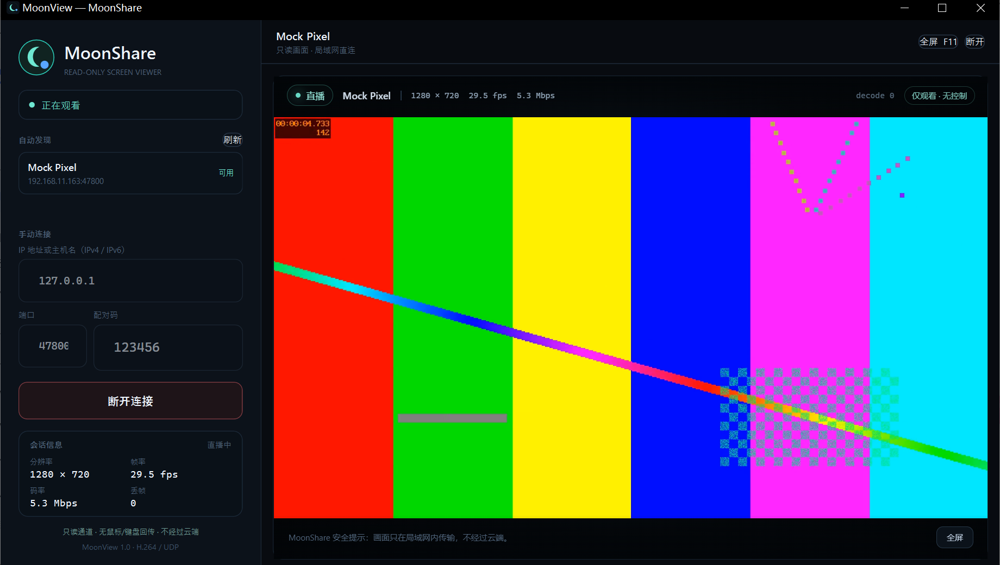

 MoonShare · 月影投屏

代码主要由Ai编写，搞着玩的:) ！！不要把它用在任何严肃场合！！

一个仿 Moonlight 思路的只读手机投屏：Android 手机采集屏幕，使用硬件
H.264 编码，通过局域网 UDP 发送到 Windows PC。观看端只能看到画面，协议里没有
鼠标、键盘或触控回传通道。

- 移动端（分享者）：`android/`，Kotlin，MediaProjection + MediaCodec H.264
- PC 端（查看者）：`pc/`，WPF + WebView2/WebCodecs，原生 Windows 窗口
- 传输：TCP 配对/控制，UDP 分片视频，H.264 Annex-B
- 网络：IPv4 / IPv6 直连；IPv4 自动发现，IPv6 手动输入地址
- 安全：6 位随机配对码、每次会话随机 token、单观看者、只读协议



## 特性

| 能力 | 实现 |
|---|---|
| 手机屏幕采集 | `MediaProjection` + `VirtualDisplay` |
| 编码 | `MediaCodec` 硬件 H.264 Baseline；GL 帧门控固定 30 fps |
| 画质 | 约 0.5 bit/像素/帧（864×1920 目标约 25 Mbps），动态内容实测 23 Mbps |
| 传输 | UDP 自定义分片，36 字节帧头，1200 字节 MTU；可选 TCP 回退 |
| 回退 | 模拟器/防火墙阻断 UDP 时，可走 TCP 47801（ADB 可转发） |
| 声音 | Android 10+ 播放捕获，48 kHz 双声道 PCM，TCP 47804 → PC Web Audio |
| 配对 | TCP 47800，6 位随机码，失败限速，会话 token |
| 观看端 | WPF 原生窗口；WebView2 内使用 WebCodecs 硬件解码 |
| 只读 | 无输入通道；观看端只接收视频 |
| IPv4 / IPv6 | 控制 TCP 双栈；视频 UDP 按观看者地址族绑定；IPv4 广播发现 |
| 发现 | UDP 47802 广播，PC 自动列出手机 |
| 延迟优化 | 无 B 帧、1 秒 IDR、UDP 不重传、丢帧请求关键帧 |

## 目录

```
MoonShare/
├─ android/                 Android 分享端（Kotlin）
│  └─ app/src/main/java/com/moonshare/
│     ├─ MainActivity.kt
│     ├─ ScreenShareService.kt
│     ├─ capture/ScreenCapture.kt
│     ├─ net/ControlServer.kt / UdpVideoTransport.kt
│     └─ protocol/Protocol.kt
├─ pc/
│  ├─ MoonView/             Windows 查看端（WPF）
│  │  ├─ Services/          TCP 控制、UDP 重组、ViewerServer
│  │  └─ web/               WebCodecs 视频渲染页
│  └─ MoonView.sln
├─ docs/
│  ├─ PROTOCOL.md           线上协议
│  ├─ ARCHITECTURE.md       架构与线程模型
│  ├─ SECURITY.md           安全边界与限制
│  └─ BUILD.md              构建/排错
└─ tools/
   ├─ mock_sharer.py        无需手机即可联调 PC 端的模拟分享者
   └─ test_pattern.h264     测试用 H.264 码流
```

## 快速开始

### 1. PC 端

运行环境：Windows 10/11、[.NET 7 Desktop Runtime + ASP.NET Core Runtime 7.0](https://dotnet.microsoft.com/download/dotnet/7.0)
（安装 .NET 7 SDK 会同时包含两者）、Microsoft Edge WebView2 Runtime（Windows 11 通常已自带）。
构建需要 .NET 7 SDK。

```powershell
cd pc
dotnet build .\MoonView.sln -c Release
.\MoonView\bin\Release\net7.0-windows\MoonView.exe
```

更完整的构建、离线 WebView2 依赖和防火墙说明见 [docs/BUILD.md](docs/BUILD.md)。

### 2. Android 端

用 Android Studio 打开 `android/`，等待 Gradle 同步（AGP 8.7.3 / Gradle 8.9+ /
JDK 17），连接手机后运行 `app`。也可以在已安装 Gradle 8.9 的环境执行：

```powershell
cd android
gradle :app:assembleDebug
adb install -r app\build\outputs\apk\debug\app-debug.apk
```

App 需要「屏幕录制」授权和通知权限。Android 14 每次开始共享都会重新弹出系统录屏授权，
这是系统限制，不是应用重复索取。

### 3. 连接

1. 手机点「开始共享屏幕」，系统弹窗中允许录屏。
2. 手机界面显示 6 位配对码、IPv4/IPv6 地址和端口 `47800`。
3. PC 端会自动发现同一广播域的手机；也可以在「手动连接」输入地址和配对码。
4. 点「连接并观看」。首次连接时 Windows 可能弹出防火墙提示，请允许
   **专用网络** 访问。
5. `F11` 切换全屏，`Esc` 退出全屏；观看端没有任何控制按钮会回传到手机。

## IPv4 / IPv6

- 控制 TCP 双栈监听；视频 UDP 会按已配对观看者的地址族绑定 IPv4 或 IPv6。
  手动输入 `192.168.1.23`、`2408:8207:...`、`fe80::...%12` 或 `[2408:...]` 均可。
- 自动发现目前走 IPv4 广播；IPv6 连接请在 PC 端手动输入手机显示的地址。
- 链路本地 IPv6（`fe80::`）需要 Windows 的接口 scope id。手机界面显示
  `%wlan0` 时，请换成 Windows 的接口编号（`fe80::...%12`），或改用手机上的
  全局 IPv6 地址。`ipconfig /all` 可以查看接口编号。
- 两台设备必须能互相路由；访客 Wi-Fi/AP 隔离会阻断连接。

## 工作方式

```
Android                                      Windows PC
┌─────────────────────────────┐              ┌──────────────────────────────┐
│ MediaProjection             │              │ WPF 窗口                     │
│   └─ VirtualDisplay         │              │  ├─ TCP 控制客户端           │
│        └─ MediaCodec H.264  │  TCP 47800   │  ├─ UDP 重组 + 会话校验      │
│             └─ UDP 分片 ────┼─────────────▶│  ├─ 本地 loopback HTTP/WS    │
│                                 UDP 47801  │  └─ WebView2 + WebCodecs     │
│ 配对码 / token / 单观看者    │              │       └─ Canvas 渲染          │
└─────────────────────────────┘              └──────────────────────────────┘
```

完整报文格式见 [docs/PROTOCOL.md](docs/PROTOCOL.md)，线程和设计取舍见
[docs/ARCHITECTURE.md](docs/ARCHITECTURE.md)。

## 无手机联调

仓库带一个模拟分享者，可用来验证 PC 端的配对、IPv4/IPv6、UDP 重组和 H.264 解码：

```powershell
cd tools
python .\mock_sharer.py --file .\test_pattern.h264 --code 123456
# 另开窗口
cd ..\pc
dotnet run --project .\MoonView -- --host 127.0.0.1 --code 123456
```

模拟器也响应 IPv4 发现广播，PC 左侧会出现 `Mock Pixel`。IPv6 可把 `--host` 改成 `::1`。

## 已知限制

- 单观看者：v1 只允许一个已配对观看者，第二个连接返回 `busy`。
- 无加密：配对码只阻止误连，不防同网段抓包/重放。请只在可信局域网使用，
  或套 VPN。详见 [docs/SECURITY.md](docs/SECURITY.md)。
- 旋转屏幕：分享开始后以当时方向建立编码器；旋转手机后建议停止并重新开始共享。
- IPv6 自动发现：暂未实现，手动输入地址可用。
- H.264 解码：PC 端依赖 WebView2 的 WebCodecs/H.264 支持；极老机器可能退回软解。
- 仅 Windows PC 端：本仓库的查看端是 WPF；协议本身可用于其他平台。

   第三方与许可

源码采用 MIT License。`pc/MoonView/lib/webview2/` 内含 Microsoft WebView2 SDK
可再发行组件，版权归 Microsoft；H.264 编解码可能涉及专利许可。详见
[THIRD_PARTY_NOTICES.md](THIRD_PARTY_NOTICES.md)。
